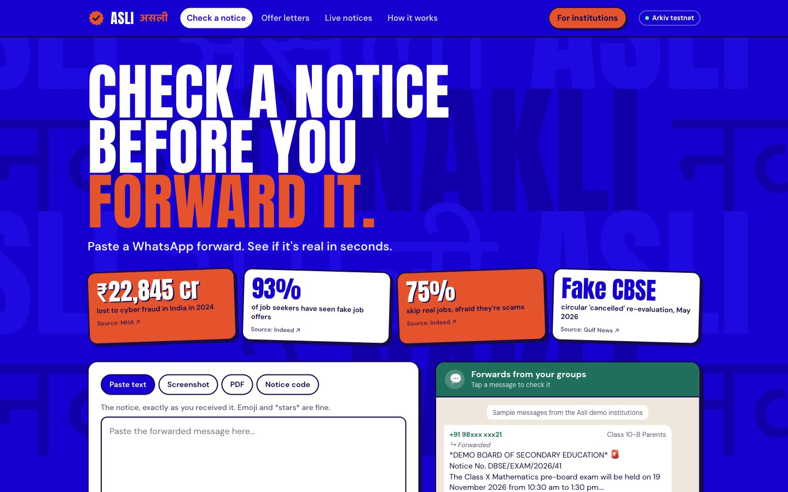
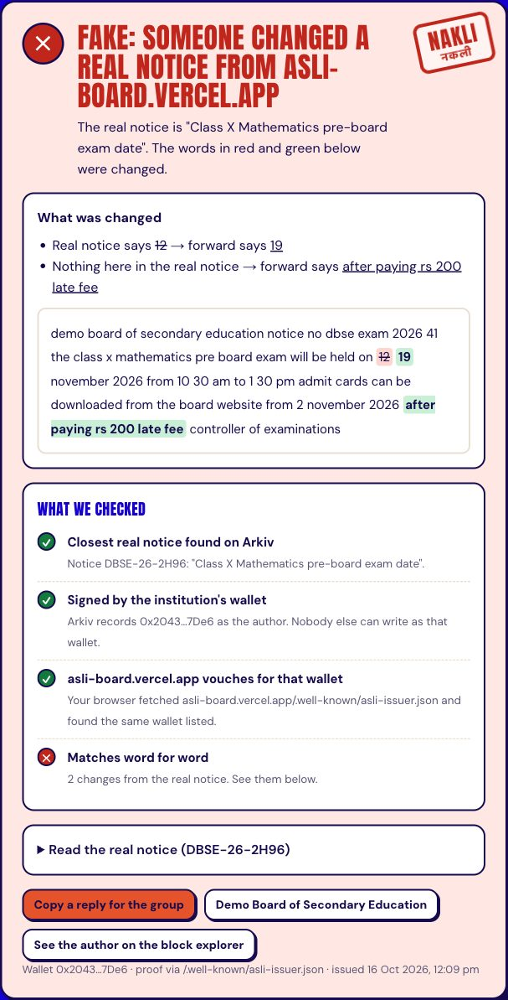
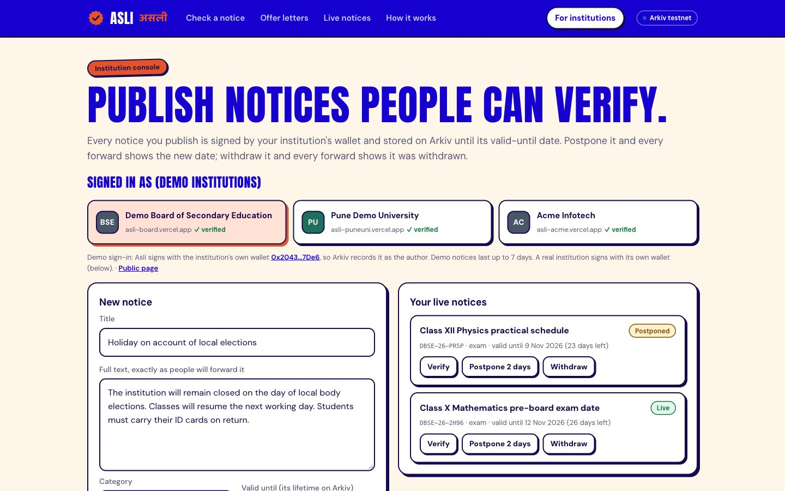
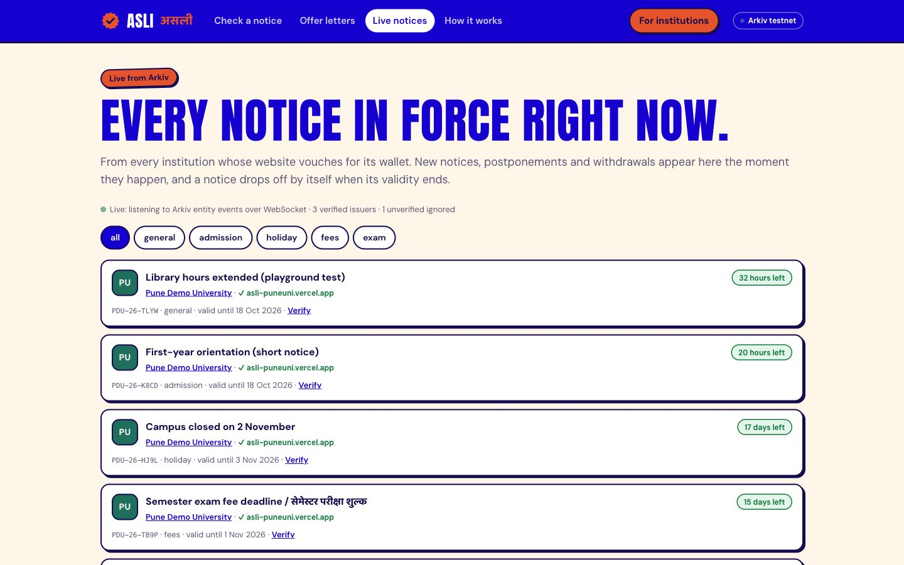

# Asli (असली): is this notice real?

A fake "CBSE exam cancelled" circular reaches a parent's WhatsApp before any denial does. A fake
offer letter with a real company's logo asks a graduate for a "training deposit". Today the only
advice is "check the official website".

**Asli** lets institutions publish their notices on [Arkiv](https://arkiv.network), and lets
anyone check a forward in seconds: paste the text, drop the PDF or a screenshot, or type the
notice code. The answer comes straight from Arkiv and the institution's own domain, read by the
reader's browser:

- ✅ **Real**: published by the institution, still in force (and postponed, if it was)
- ❌ **Altered**: a real notice with words changed. Asli shows exactly which ("12 → 19 November", "+ pay Rs 200 late fee")
- ❌ **Withdrawn**: the institution revoked it, with its reason
- ⚠️ **Expired**: it was real, but its validity has ended
- ❌ **Unverified issuer**: someone published it claiming to be the institution, but the institution's domain does not vouch for their wallet
- ❔ **Unknown**: no institution on Asli published anything like it

Built for the Arkiv Global Tour Stop (pre-Devcon 8, Mumbai). Tracks: **Best Indian Use Case**, Security, Censorship Resistance.

- **Live app:** https://asli-verify.vercel.app (see the deploy notes below if this moves)
- **Schema:** [`arkiv/schema.md`](arkiv/schema.md) · **Friction report:** [`arkiv/friction.md`](arkiv/friction.md)
- **Wallets that create entities:** listed in [`arkiv/schema.md`](arkiv/schema.md#wallets-that-create-entities-tiramisu) and [`arkiv/seed-output.json`](arkiv/seed-output.json)

All issuers, notices and documents are **fictional demo data**. No real institution, brand or person is represented.

<p align="center"></p>

<table><tr>
<td width="42%"></td>
<td><br><br></td>
</tr></table>

## For judges: where everything is

| Requirement | Where |
|---|---|
| Public deployment | https://asli-verify.vercel.app (issuer domains: `asli-board`, `asli-puneuni`, `asli-acme` `.vercel.app`) |
| MIT, open source | this repo, [`LICENSE`](LICENSE) |
| Entity schema | [`arkiv/schema.md`](arkiv/schema.md) (kept in sync with the code by `tests/unit/docs.test.ts`) |
| Friction report | [`arkiv/friction.md`](arkiv/friction.md): 8 entries, each with expected, actual, repro and fix |
| Entity-creating wallets | the table below, and [`arkiv/seed-output.json`](arkiv/seed-output.json) with every entity key and transaction |
| Tests | `npm test`: 124 unit tests; `ARKIV_INTEGRATION=1 npm test` adds live Tiramisu tests |

### Wallets that create entities (Tiramisu, chain 7738577)

| Role | Wallet | Domain that vouches for it |
|---|---|---|
| Demo Board of Secondary Education | [`0x2043DB00a32bd8C4804227B72b97438af39a7De6`](https://tiramisu.explorer.arkiv.network/address/0x2043DB00a32bd8C4804227B72b97438af39a7De6) | asli-board.vercel.app |
| Pune Demo University | [`0x94a9C31a9dcdd7EBD44b9c4d7511a27149ec6F81`](https://tiramisu.explorer.arkiv.network/address/0x94a9C31a9dcdd7EBD44b9c4d7511a27149ec6F81) | asli-puneuni.vercel.app |
| Acme Infotech (offer letters) | [`0x51Ad2Cf42bc81C254bcdd078e15c75890532905f`](https://tiramisu.explorer.arkiv.network/address/0x51Ad2Cf42bc81C254bcdd078e15c75890532905f) | asli-acme.vercel.app |
| Impostor (claims the board's name) | [`0x1E4f823262253f131fAdE44a3A6b1574C01a7062`](https://tiramisu.explorer.arkiv.network/address/0x1E4f823262253f131fAdE44a3A6b1574C01a7062) | none: the board's domain lists a different wallet, so Asli flags it |

## Try it in one minute (no wallet)

1. Open https://asli-verify.vercel.app. In **Forwards from your groups**, tap the first message
   (a doctored forward). You get **Fake: someone changed a real notice**, the NAKLI stamp, the
   moved date (12 → 19) and the added fee highlighted, and **What we checked**: found on Arkiv,
   signed by the board's wallet, the board's domain vouches for it, does not match word for word.
2. Tap the other messages: a real copy, a postponed notice, a withdrawn one, a Hindi + English
   circular, an impostor, and a short-lived notice that turns **Expired** after 18 Oct.
3. **Notice code**: type `DBSE-26-2H96`, or open https://asli-verify.vercel.app/?code=DBSE-26-PR5P.
4. **Live notices**: every notice in force, updated over Arkiv's WebSocket events with no refresh.
5. **For institutions**: pick a demo institution, publish a notice, then postpone or withdraw it,
   and watch the live board and the verdicts change. Each write links to its transaction.
6. **Offer letters**: check [`acme-offer-letter.pdf`](public/samples/acme-offer-letter.pdf)
   (registered by Acme) and [`acme-offer-letter-edited.pdf`](public/samples/acme-offer-letter-edited.pdf)
   (the scammer's copy). Only the file's fingerprint is compared.

## Reproduce the Arkiv usage yourself (no Asli needed)

Any notice can be checked with one JSON-RPC call to the public Tiramisu RPC:

```bash
curl -s https://rpc.tiramisu.db-chain.testnet.arkiv.network -H 'content-type: application/json' -d '{
  "jsonrpc":"2.0","id":1,"method":"arkiv_query",
  "params":["app = str('"'"'asli_v1'"'"') AND kind = str('"'"'issuer'"'"')",
            {"select":{"key":true,"creator":true,"expiresAt":true,"attributes":true}}]}'
```

Then check that a creator is trusted: `curl https://asli-board.vercel.app/.well-known/asli-issuer.json`.
All queries are listed in [`arkiv/schema.md`](arkiv/schema.md#queries-the-app-runs).

## How it uses Arkiv, and why

| Feature | How Asli uses it | What the user sees |
|---|---|---|
| Entity Expiration | A notice's lifetime **is** its validity (`ExpirationTime.atDate`). Offers live until the acceptance deadline. | Expired notices stop verifying as current, with no date check in Asli. |
| Lifetime Extension | Postponement extends the notice. Issuers renew yearly. | "Postponed by the issuer" with the reason. |
| Creation flags | Notices are `readonly`. Revocations allow `permissionlessExtension`. | A published notice cannot be quietly reworded. Anyone can keep a withdrawal warning alive. |
| `$creator` | The only issuer identity. Every query filters by it, never by an attribute. | An impostor using the board's name and domain shows as "unverified issuer". |
| Typed attributes and queries | `bytes32` hashes, `u64` timestamps, `key` links, compound `AND`, `$creator`, cursor pagination | Instant exact lookups; fuzzy matching over an issuer's live notices. |
| Atomic batches | Postpone = extend + amendment. Revoke = revocation + delete. | Never a half-done postponement or a vanished notice with no explanation. |
| Historical reads (`atBlock`) | The same narrow query at earlier blocks | "Was real, but no longer in force" instead of "unknown". |
| WebSocket entity events | `watchEntityEvents`, no `fromBlock` | The live board updates without a refresh. |

**Why not Postgres, IPFS, a subgraph or our own API?** A checker that the checker controls is
one more thing to trust: we could forge a "real" or delete an inconvenient notice. On Arkiv the
author is the chain-set `$creator`, readers query without us, expiry is a protocol guarantee,
and the queries Asli depends on (by hash, by creator, by time) are native. IPFS cannot answer
"all live notices from this board". A subgraph puts an operator back in the middle and turns
expiry into our own date comparison.

**Who is in the read path.** The browser reads Arkiv's public RPC and the institution's
`/.well-known/asli-issuer.json` itself; Asli's server is not involved, so Asli cannot forge a
"real". Arkiv also has an anonymous query budget (about 100 queries, see
[friction #8](arkiv/friction.md)). Only when Arkiv refuses with `ANON_COST_LIMITED` does the
browser retry through Asli's read relay (`/api/arkiv`), which forwards read methods only with
Asli's access key, and the result says so.

**Kept off Arkiv on purpose:** PDFs (fingerprint only), any personal data (not even hashed), keys,
OCR and diffing (done in the browser), and the playground rate limits.

## Run locally

```bash
git clone https://github.com/0xvikram/asli && cd asli
npm install
cp .env.example .env.local     # add issuer keys and (optionally) an Arkiv access key
npm run dev                    # http://localhost:3000
npm test                       # unit tests (in-memory Arkiv fake)
ARKIV_INTEGRATION=1 npm test   # plus live Tiramisu tests (needs funded keys for writes)
npm run seed                   # publish the demo data (needs funded keys)
```

Get test GLM at https://hub.arkiv.network/faucet and an access key at
https://hub.arkiv.network/access-keys. The access key only raises the RPC quota; it is sent as
an `X-API-KEY` header from the server and never reaches the browser.

## Deploy notes

One Vercel project serves the app and the three demo issuer domains (`asli-board`,
`asli-puneuni`, `asli-acme` `.vercel.app` aliases). Each host's
`/.well-known/asli-issuer.json` lists only its own wallet, exactly as a real institution would
publish the file on its own site. Env: `ISSUER_BOARD_KEY`, `ISSUER_UNIV_KEY`,
`ISSUER_EMPLOYER_KEY`, `ARKIV_ACCESS_KEY`, and optionally `NEXT_PUBLIC_DOMAIN_*` to rename the
issuer domains.

## For a real institution

Keep the issuer key in a hardware wallet or a Safe multisig, publish the wallet in DNS
(`_asli.example.edu.in TXT "asli-issuer=0x…"`) and sign from the MetaMask console or the
`scripts/` helpers. Print the Asli code on every circular.

## Project layout

- `src/lib/normalize.ts`: text cleanup and hashing that survives WhatsApp forwarding
- `src/lib/match.ts`: word diff and similarity
- `src/lib/schema.ts`: entities, lifetimes, flags, queries
- `src/lib/arkiv/`: clients, reads, writes
- `src/lib/verify.ts`: the verdict engine
- `src/lib/domainProof.ts`: well-known and DNS-TXT issuer proofs
- `src/app/`: pages and the playground API
- `scripts/seed.ts`, `scripts/make-samples.ts`: demo data
- `tests/`: unit tests (with an in-memory Arkiv) and live integration tests

Built 16–18 Oct 2026 for the challenge. No pre-existing code beyond the `create-next-app`
scaffold (commit `10864a3`). MIT licensed.
